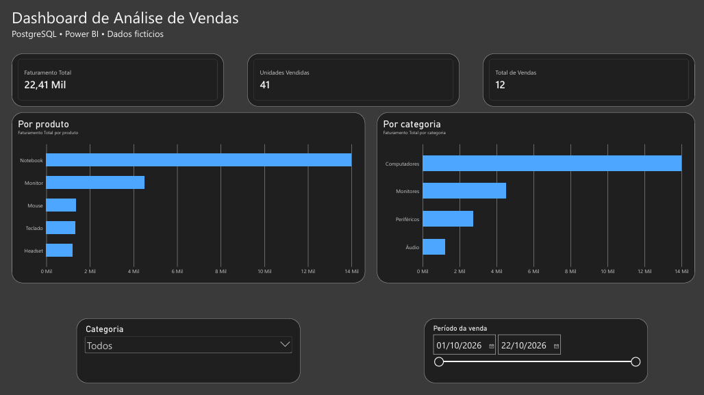

# Análise de Vendas com Python, PostgreSQL e Pandas

## Sobre o projeto

Este projeto apresenta uma análise exploratória de dados de vendas, utilizando PostgreSQL para armazenamento e consultas SQL, Python e Pandas para tratamento e análise dos dados, e Matplotlib para visualização dos resultados.

O objetivo é demonstrar um fluxo de trabalho de análise de dados, desde a criação do banco de dados até a geração de indicadores e gráficos que auxiliam na compreensão do desempenho comercial.

**Observação:** os dados utilizados são fictícios e foram criados para fins educacionais e de portfólio.

## Tecnologias utilizadas

- **Python:** linguagem de programação utilizada na análise.
- **PostgreSQL:** banco de dados relacional.
- **SQL:** criação de tabelas, inserção e consulta de dados.
- **Pandas:** manipulação e análise de dados.
- **SQLAlchemy:** integração entre Python e PostgreSQL.
- **psycopg:** driver de conexão com PostgreSQL.
- **Matplotlib:** criação de gráficos.
- **Jupyter Notebook:** desenvolvimento e apresentação das análises.
- **VS Code:** ambiente de desenvolvimento.
- **Git e GitHub:** versionamento e publicação do projeto.

## Indicadores analisados

| Indicador | Resultado |
|---|---:|
| Registros de vendas | 12 |
| Unidades vendidas | 41 |
| Faturamento total | R$ 22.410,00 |
| Produtos cadastrados | 5 |
| Categorias de produtos | 4 |

## Faturamento por produto

| Produto | Faturamento |
|---|---:|
| Notebook | R$ 14.000,00 |
| Monitor | R$ 4.500,00 |
| Mouse | R$ 1.360,00 |
| Teclado | R$ 1.350,00 |
| Headset | R$ 1.200,00 |
| **Total** | **R$ 22.410,00** |

## Faturamento por categoria

| Categoria | Faturamento |
|---|---:|
| Computadores | R$ 14.000,00 |
| Monitores | R$ 4.500,00 |
| Periféricos | R$ 2.710,00 |
| Áudio | R$ 1.200,00 |

## Visualizações

Foram desenvolvidos dois gráficos utilizando Matplotlib:

1. **Faturamento por produto:** comparação da receita gerada pelos produtos.
2. **Faturamento por categoria:** identificação das categorias com maior participação no faturamento.

Os gráficos e os códigos utilizados estão disponíveis no notebook `analise_postgresql.ipynb`.

## Principais insights

- O Notebook foi o produto com maior faturamento, representando aproximadamente 62,5% da receita total.
- A categoria Computadores liderou o faturamento.
- O Monitor apresentou o segundo maior faturamento entre os produtos.
- Os periféricos (Mouse e Teclado) geraram juntos R$ 2.710,00.
- Os resultados demonstram uma concentração relevante da receita em produtos de maior valor unitário.

Essas observações são referentes exclusivamente ao conjunto de dados fictício utilizado.

## Estrutura do projeto

```text
analise de dados/
├── sql/
│   ├── 01_criar_tabelas.sql
│   ├── 02_inserir_dados.sql
│   └── 03_consultas.sql
├── analise_postgresql.ipynb
├── requirements.txt
├── .gitignore
└── README.md
```

## Como executar o projeto

**Pré-requisitos:** Python, PostgreSQL e acesso a um ambiente de desenvolvimento compatível com Jupyter Notebook.

### 1. Preparar o ambiente Python

Clone o repositório e acesse a pasta do projeto.

Crie e ative um ambiente virtual:

```powershell
python -m venv .venv
.\.venv\Scripts\Activate.ps1
```

Instale as dependências:

```powershell
python -m pip install -r requirements.txt
```

### 2. Preparar o banco de dados

No PostgreSQL, crie um banco chamado `analise_vendas`.

Execute os scripts SQL nesta ordem:

1. `sql/01_criar_tabelas.sql`
2. `sql/02_inserir_dados.sql`
3. `sql/03_consultas.sql` (consultas de análise)

### 3. Configurar a conexão

Crie um arquivo `.env` na raiz do projeto com as variáveis:

```dotenv
PGHOST=127.0.0.1
PGPORT=5432
PGDATABASE=analise_vendas
PGUSER=postgres
PGPASSWORD=SUBSTITUA_PELA_SUA_SENHA
```

O arquivo `.env` contém credenciais locais e não deve ser enviado ao GitHub.

### 4. Executar o notebook

Abra `analise_postgresql.ipynb` no VS Code, selecione o kernel Python do ambiente virtual e execute as células na ordem.

O notebook consulta o PostgreSQL, carrega os dados no Pandas, calcula indicadores e gera gráficos.

## Aprendizados

Este projeto permitiu praticar:

- Modelagem básica de banco de dados relacional.
- Criação de tabelas com chaves primárias e estrangeiras.
- Consultas SQL com `JOIN` e agregações.
- Conexão segura entre Python e PostgreSQL.
- Manipulação de DataFrames com Pandas.
- Validação de indicadores.
- Visualização de dados com Matplotlib.
- Versionamento de código com Git e GitHub.

## Próximos passos

- Criar um dashboard interativo no Power BI.
- Adicionar análises de faturamento ao longo do tempo.
- Explorar novos indicadores de desempenho.
- Expandir a base de dados para análises mais detalhadas.

---

**Projeto educacional de análise de dados desenvolvido para fins de aprendizado e portfólio profissional.**

## Dashboard no Power BI

Foi desenvolvido um dashboard interativo no Power BI Desktop, utilizando dados armazenados no PostgreSQL.

### Indicadores principais

- **Faturamento total:** R$ 22.410,00
- **Unidades vendidas:** 41
- **Registros de vendas:** 12
- **Produto com maior faturamento:** Notebook
- **Categoria com maior faturamento:** Computadores

### Funcionalidades

- Indicadores calculados com medidas DAX.
- Gráfico de faturamento por produto.
- Gráfico de faturamento por categoria.
- Filtros interativos por categoria e data.
- Modelo relacional entre as tabelas `produtos` e `vendas`.

### Visualização do dashboard


[Visualizar o dashboard em PDF](dashboard_vendas.pdf)

**Observação:** os dados são fictícios e utilizados exclusivamente para fins educacionais e de portfólio.